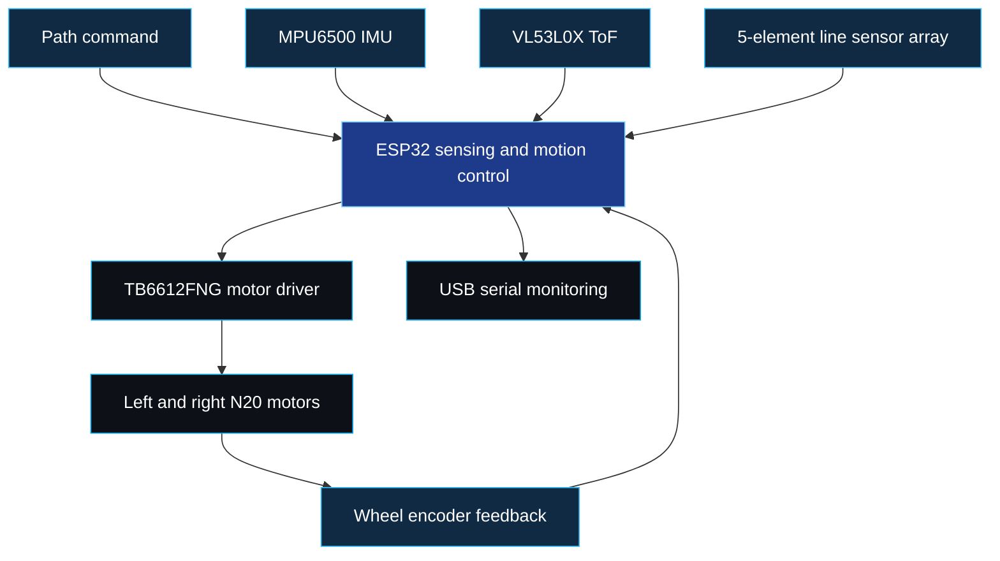

<!-- ANIMATED HEADER -->

  

<h1 align="center">🛞 Differential Drive Robot</h1>

<h3 align="center">
  ESP32 · Sensor Fusion · Motion Control · Custom PCB
</h3>

  

  <b>Connecting embedded electronics, mechanical design, and feedback control.</b>

  
  
  
  

  <a href="#overview">Overview</a> ·
  <a href="#robot-gallery">Gallery</a> ·
  <a href="#system-overview">System</a> ·
  <a href="#hardware-components">Hardware</a> ·
  <a href="#pin-connections">Connections</a> ·
  <a href="#motion-control">Motion Control</a> ·
  <a href="#code-and-project-files">Code</a> ·
  <a href="#ongoing-development">Development</a>

---

<h2 align="center">Overview</h2>

  An <b>ESP32-based differential drive mobile robot</b> combining
  an <b>MPU6500 IMU</b>, a <b>VL53L0X Time-of-Flight sensor</b>,
  and <b>N20 encoder motors</b> for sensing, localization experiments,
  obstacle detection, and motion control.

  The project explores <b>sensor fusion</b> and
  <b>PID/non-PID control</b> through straight-line,
  square, and circular path execution.

  A <b>custom PCB</b> integrates the IMU, motor driver,
  and battery-charging circuitry.
  The mechanical assembly uses a <b>3D-printed chassis and wheels</b>.

  <b>Mathematical modeling, GUI visualization, and CSV data workflows
  remain under development.</b>

  <code>SENSE</code>
  &nbsp; → &nbsp;
  <code>ESTIMATE</code>
  &nbsp; → &nbsp;
  <code>CONTROL</code>
  &nbsp; → &nbsp;
  <code>MOVE</code>
  &nbsp; ↻

---

<h2 align="center">Project Highlights</h2>

<table align="center">
  <tr>
    <td width="50%" align="center" valign="top">
      <h3>🧭 Sensing &amp; Feedback</h3>
      

        Combine IMU measurements, distance sensing,
        and wheel-encoder feedback to study robot motion.
      

      

        <code>MPU6500</code>
        <code>VL53L0X</code>
        <code>Encoders</code>
      

    </td>
    <td width="50%" align="center" valign="top">
      <h3>🎯 Motion Control</h3>
      

        Compare PID and non-PID approaches across
        straight-line, square, and circular trajectories.
      

      

        <code>PID</code>
        <code>Path Tracking</code>
        <code>Motor Control</code>
      

    </td>
  </tr>
  <tr>
    <td width="50%" align="center" valign="top">
      <h3>🔌 Custom Electronics</h3>
      

        Bring the IMU, motor driver, and battery-charging
        circuitry together on a project-specific PCB.
      

      

        <code>PCB Design</code>
        <code>TB6612FNG</code>
        <code>Integration</code>
      

    </td>
    <td width="50%" align="center" valign="top">
      <h3>🖨️ Mechanical Design</h3>
      

        Build the robot around a 3D-printed chassis,
        with printable parts available in the repository.
      

      

        <code>3D Printing</code>
        <code>Chassis</code>
        <code>Motor Mounts</code>
      

    </td>
  </tr>
</table>

---

<h2 align="center">Robot Gallery</h2>

  <b>📸 From CAD and circuitry to a physical robot.</b>

<!-- Equal image heights keep the gallery aligned without stretching photos. -->

  <table align="center">
    <tr>
      <th width="50%" align="center">🛞 Side / Top View</th>
      <th width="50%" align="center">🤖 Front View</th>
    </tr>
    <tr>
      <td width="50%" align="center" valign="middle">
        
      </td>
      <td width="50%" align="center" valign="middle">
        
      </td>
    </tr>
    <tr>
      <th width="50%" align="center">🔌 Back / Top View</th>
      <th width="50%" align="center">🖨️ Base View</th>
    </tr>
    <tr>
      <td width="50%" align="center" valign="middle">
        
      </td>
      <td width="50%" align="center" valign="middle">
        
      </td>
    </tr>
  </table>

  Click any photograph to view it at full size.

  <a href="https://github.com/sdqxmd/Differential-Drive-Robot/tree/main/Robot%20Images">
    <b>Explore all robot images →</b>
  </a>

---

<h2 align="center">System Overview</h2>

  <b>Sensor measurements inform the controller; encoder feedback closes the loop.</b>

<!-- Functional signal flow, not a power-wiring schematic. -->

---

<h2 align="center">Hardware Components</h2>

  <table align="center">
    <thead>
      <tr>
        <th align="center">Component</th>
        <th align="center">Role</th>
      </tr>
    </thead>
    <tbody>
      <tr>
        <td align="center"><b>ESP32 Dev Kit</b></td>
        <td align="center">Main controller for sensing and motion control</td>
      </tr>
      <tr>
        <td align="center"><b>MPU6500 IMU</b></td>
        <td align="center">Inertial measurements for motion and orientation estimation</td>
      </tr>
      <tr>
        <td align="center"><b>VL53L0X ToF Sensor</b></td>
        <td align="center">Distance measurement and obstacle sensing</td>
      </tr>
      <tr>
        <td align="center"><b>Two N20 DC Encoder Motors</b></td>
        <td align="center">Differential drive actuation and wheel feedback</td>
      </tr>
      <tr>
        <td align="center"><b>TB6612FNG Motor Driver</b></td>
        <td align="center">Independent control of the two motors</td>
      </tr>
      <tr>
        <td align="center"><b>5-Element Line Sensor Array</b></td>
        <td align="center">Line-sensor inputs for supported sketches</td>
      </tr>
      <tr>
        <td align="center"><b>12V Battery Pack</b></td>
        <td align="center">Robot power source</td>
      </tr>
      <tr>
        <td align="center"><b>Custom PCB</b></td>
        <td align="center">Integration of the IMU, motor driver, and charging circuitry</td>
      </tr>
      <tr>
        <td align="center"><b>3D-Printed Chassis and Wheels</b></td>
        <td align="center">Mechanical structure and mobility</td>
      </tr>
    </tbody>
  </table>

---

<h2 align="center">Pin Connections</h2>

<h3 align="center">⚙️ Motor Driver — TB6612FNG</h3>

  <table align="center">
    <thead>
      <tr>
        <th align="center">Signal</th>
        <th align="center">Function</th>
        <th align="center">Documented ESP32 Wiring</th>
      </tr>
    </thead>
    <tbody>
      <tr>
        <td align="center"><code>PWMA</code></td>
        <td align="center">Left motor PWM</td>
        <td align="center"><code>GPIO 26</code></td>
      </tr>
      <tr>
        <td align="center"><code>AIN1</code></td>
        <td align="center">Left motor direction input 1</td>
        <td align="center"><code>GPIO 14</code></td>
      </tr>
      <tr>
        <td align="center"><code>AIN2</code></td>
        <td align="center">Left motor direction input 2</td>
        <td align="center"><code>GPIO 27</code></td>
      </tr>
      <tr>
        <td align="center"><code>PWMB</code></td>
        <td align="center">Right motor PWM</td>
        <td align="center"><code>GPIO 32</code></td>
      </tr>
      <tr>
        <td align="center"><code>BIN1</code></td>
        <td align="center">Right motor direction input 1</td>
        <td align="center"><code>GPIO 33</code></td>
      </tr>
      <tr>
        <td align="center"><code>BIN2</code></td>
        <td align="center">Right motor direction input 2</td>
        <td align="center"><code>GPIO 12</code></td>
      </tr>
      <tr>
        <td align="center"><code>STBY</code></td>
        <td align="center">Standby control</td>
        <td align="center"><code>GPIO 25</code></td>
      </tr>
    </tbody>
  </table>

> **Pin-mapping check:** The table preserves the project's supplied wiring notes. The current [`Full_Code.ino`](Robot%20Codes/Full_Code.ino) defines `AIN1 = 27` and `AIN2 = 14`, which reverses these two assignments. Confirm the actual PCB connections and make the selected sketch match before running the robot.

<h3 align="center">🔄 Encoder Connections</h3>

  <table align="center">
    <thead>
      <tr>
        <th align="center">Encoder Signal</th>
        <th align="center">ESP32 Pin</th>
      </tr>
    </thead>
    <tbody>
      <tr>
        <td align="center">Left Encoder A</td>
        <td align="center"><code>GPIO 34</code></td>
      </tr>
      <tr>
        <td align="center">Left Encoder B</td>
        <td align="center"><code>GPIO 35</code></td>
      </tr>
      <tr>
        <td align="center">Right Encoder A</td>
        <td align="center"><code>GPIO 39</code></td>
      </tr>
      <tr>
        <td align="center">Right Encoder B</td>
        <td align="center"><code>GPIO 36</code></td>
      </tr>
    </tbody>
  </table>

<h3 align="center">〰️ Line Sensors — 5-Element Array</h3>

  <table align="center">
    <thead>
      <tr>
        <th align="center">Sensor</th>
        <th align="center">ESP32 Pin</th>
      </tr>
    </thead>
    <tbody>
      <tr>
        <td align="center"><code>LS1</code></td>
        <td align="center"><code>GPIO 4</code></td>
      </tr>
      <tr>
        <td align="center"><code>LS2</code></td>
        <td align="center"><code>GPIO 17</code></td>
      </tr>
      <tr>
        <td align="center"><code>LS3</code></td>
        <td align="center"><code>GPIO 16</code></td>
      </tr>
      <tr>
        <td align="center"><code>LS4</code></td>
        <td align="center"><code>GPIO 15</code></td>
      </tr>
      <tr>
        <td align="center"><code>LS5</code></td>
        <td align="center"><code>GPIO 13</code></td>
      </tr>
    </tbody>
  </table>

<h3 align="center">🧭 IMU and ToF — I²C Connections</h3>

  <table align="center">
    <thead>
      <tr>
        <th align="center">Sensor Pin</th>
        <th align="center">MPU6500 → ESP32</th>
        <th align="center">VL53L0X → ESP32</th>
      </tr>
    </thead>
    <tbody>
      <tr>
        <td align="center"><code>VCC</code></td>
        <td align="center"><code>3.3V</code></td>
        <td align="center"><code>3.3V</code></td>
      </tr>
      <tr>
        <td align="center"><code>GND</code></td>
        <td align="center"><code>GND</code></td>
        <td align="center"><code>GND</code></td>
      </tr>
      <tr>
        <td align="center"><code>SDA</code></td>
        <td align="center"><code>GPIO 21</code></td>
        <td align="center"><code>GPIO 21</code></td>
      </tr>
      <tr>
        <td align="center"><code>SCL</code></td>
        <td align="center"><code>GPIO 22</code></td>
        <td align="center"><code>GPIO 22</code></td>
      </tr>
    </tbody>
  </table>

  
    Both sensors share the I²C bus.
    The IMU is labeled MPU6500 here to match the hardware list
    and the repository's IMU_MPU_6500_RPY.ino sketch.
  

<h3 align="center">🔗 Serial Communication</h3>

  <table align="center">
    <thead>
      <tr>
        <th align="center">Setting</th>
        <th align="center">Value</th>
      </tr>
    </thead>
    <tbody>
      <tr>
        <td align="center">Baud rate</td>
        <td align="center"><code>115200</code></td>
      </tr>
      <tr>
        <td align="center">Interface</td>
        <td align="center"><code>USB</code></td>
      </tr>
    </tbody>
  </table>

---

<h2 align="center">Software and Libraries</h2>

  <table align="center">
    <thead>
      <tr>
        <th align="center">Tool / Library</th>
        <th align="center">Use</th>
      </tr>
    </thead>
    <tbody>
      <tr>
        <td align="center"><b>Arduino IDE with ESP32 support</b></td>
        <td align="center">Build and upload the robot sketches</td>
      </tr>
      <tr>
        <td align="center"><code>Wire</code></td>
        <td align="center">I²C communication; supplied with the board support package</td>
      </tr>
      <tr>
        <td align="center"><code>Adafruit_VL53L0X</code></td>
        <td align="center">VL53L0X distance-sensor support</td>
      </tr>
      <tr>
        <td align="center"><code>Madgwick</code></td>
        <td align="center">Optional orientation-filter library for sketches that use it</td>
      </tr>
    </tbody>
  </table>

  
    Install external libraries through the Arduino Library Manager.
    Check the selected sketch's include statements for its dependencies.
  

> **IMU implementation:** The current `IMU_MPU_6500_RPY.ino` sketch reads the IMU through `Wire` and uses complementary filtering for roll and pitch. It does not currently import the Madgwick library.

---

<h2 align="center">Motion Control</h2>

  <b>Explore the effect of control strategy on robot motion.</b>

  <table align="center">
    <thead>
      <tr>
        <th align="center">Trajectory</th>
        <th align="center">PID Version</th>
        <th align="center">Non-PID Version</th>
      </tr>
    </thead>
    <tbody>
      <tr>
        <td align="center">📏 <b>Straight Line</b></td>
        <td align="center">
          <a href="Robot%20Codes/Straight_Line_with_PID.ino">View sketch</a>
        </td>
        <td align="center">
          <a href="Robot%20Codes/Straight_Line_without_PID.ino">View sketch</a>
        </td>
      </tr>
      <tr>
        <td align="center">🔲 <b>Square Path</b></td>
        <td align="center">
          <a href="Robot%20Codes/Square_Path_with_PID.ino">View sketch</a>
        </td>
        <td align="center">
          <a href="Robot%20Codes/Square_Path_without_PID.ino">View sketch</a>
        </td>
      </tr>
      <tr>
        <td align="center">⭕ <b>Circular Path</b></td>
        <td align="center">
          <a href="Robot%20Codes/Circle_Path_with_PID.ino">View sketch</a>
        </td>
        <td align="center">
          <a href="Robot%20Codes/Circle_Path_without_PID.ino">View sketch</a>
        </td>
      </tr>
    </tbody>
  </table>

  
    Additional yaw-lock and calibration sketches are available
    in the Robot Codes folder.
  

---

<h2 align="center">Code and Project Files</h2>

  Individual sensor sketches, combined system code,
  motion-control examples, and GUI source are included.

  <table align="center">
    <thead>
      <tr>
        <th align="center">Folder</th>
        <th align="center">Contents</th>
      </tr>
    </thead>
    <tbody>
      <tr>
        <td align="center">
          <a href="Robot%20Codes"><b>Robot Codes</b></a>
        </td>
        <td align="center">
          Sensor tests, calibration, combined firmware,
          path-control sketches, and GUI source
        </td>
      </tr>
      <tr>
        <td align="center">
          <a href="3D%20Prints"><b>3D Prints</b></a>
        </td>
        <td align="center">
          Printable robot base, front, top, and motor-clamp STL files
        </td>
      </tr>
      <tr>
        <td align="center">
          <a href="PCB%20Design"><b>PCB Design</b></a>
        </td>
        <td align="center">
          PCB design PDF and layout image
        </td>
      </tr>
      <tr>
        <td align="center">
          <a href="Robot%20Images"><b>Robot Images</b></a>
        </td>
        <td align="center">
          Photographs of the robot and its assembly
        </td>
      </tr>
    </tbody>
  </table>

<b>📂 Quick links to individual sketches</b>

 

| Purpose | File |
| :--- | :--- |
| Combined system firmware | [Full_Code.ino](Robot%20Codes/Full_Code.ino) |
| IMU roll, pitch, and yaw | [IMU_MPU_6500_RPY.ino](Robot%20Codes/IMU_MPU_6500_RPY.ino) |
| IMU calibration | [IMU_Calibration_0to360.ino](Robot%20Codes/IMU_Calibration_0to360.ino) |
| ToF sensor test | [TOF.ino](Robot%20Codes/TOF.ino) |
| Encoder distance, RPM, and speed | [Encoders_Distance_RPM_Speed.ino](Robot%20Codes/Encoders_Distance_RPM_Speed.ino) |
| Encoder and ToF calibration | [Encoder_TOF_Calibration.ino](Robot%20Codes/Encoder_TOF_Calibration.ino) |
| Line-sensor test | [Line_Sensor.ino](Robot%20Codes/Line_Sensor.ino) |
| GUI-side ESP32 firmware | [DDR_GUI.ino](Robot%20Codes/DDR_GUI.ino) |
| Python GUI | [DDR_GUI_PYTHON.py](Robot%20Codes/DDR_GUI_PYTHON.py) |

---

<h2 align="center">3D Printing and PCB Design</h2>

<table align="center">
  <tr>
    <td width="50%" align="center" valign="top">
      <h3>🖨️ Mechanical Files</h3>
      

        STL files for the robot's structural parts
        and motor mounting.
      

      

        <a href="3D%20Prints/Robot_Base.stl">Base</a> ·
        <a href="3D%20Prints/Robot_Front.stl">Front</a> ·
        <a href="3D%20Prints/Robot_Top.stl">Top</a> ·
        <a href="3D%20Prints/Robot_Motors_Clamp.stl">Motor Clamp</a>
      

      

        <a href="3D%20Prints">
          <b>Explore printable parts →</b>
        </a>
      

    </td>
    <td width="50%" align="center" valign="top">
      <h3>🔌 PCB Design</h3>
      

        A custom board integrating the IMU,
        motor driver, and battery-charging circuitry.
      

      

        <code>Sensor Integration</code>
        <code>Motor Driver</code>
        <code>Charging Circuit</code>
      

      

        <a href="PCB%20Design">
          <b>Explore the PCB files →</b>
        </a>
      

    </td>
  </tr>
</table>

<b>🔍 View the PCB layout</b>

 

  

  <a href="PCB%20Design/Differencial%20Drive%20Robot%20PCB%20Design.pdf">
    <b>Open the PCB design PDF →</b>
  </a>

---

<h2 align="center">Ongoing Development</h2>

  

  <table align="center">
    <thead>
      <tr>
        <th align="center">Workstream</th>
        <th align="center">Current Focus</th>
      </tr>
    </thead>
    <tbody>
      <tr>
        <td align="center">📐 <b>Mathematical Modeling</b></td>
        <td align="center">
          Developing the mathematical model of the differential drive robot
        </td>
      </tr>
      <tr>
        <td align="center">🖥️ <b>GUI Visualization</b></td>
        <td align="center">
          Continuing development of the desktop visualization interface
        </td>
      </tr>
      <tr>
        <td align="center">📊 <b>CSV Data Workflows</b></td>
        <td align="center">
          Developing and refining GUI-based data handling and analysis
        </td>
      </tr>
    </tbody>
  </table>

  
    GUI source is available in the repository.
    These tools remain under development.
  

---

<h2 align="center">Applications</h2>

  🤖 <b>Autonomous Mobile Robot Experiments</b>
  &nbsp; · &nbsp;
  🧭 <b>SLAM and Localization Research</b>

  🏁 <b>Robotics Competitions</b>
  &nbsp; · &nbsp;
  📡 <b>Smart Navigation Systems</b>

---

<h2 align="center">Learning Outcomes</h2>

  <table align="center">
    <thead>
      <tr>
        <th align="center">Area</th>
        <th align="center">Skills Developed</th>
      </tr>
    </thead>
    <tbody>
      <tr>
        <td align="center">🧭 <b>Sensing</b></td>
        <td align="center">Sensor fusion and IMU, ToF, and encoder integration</td>
      </tr>
      <tr>
        <td align="center">🔌 <b>Embedded Systems</b></td>
        <td align="center">ESP32 programming and hardware interfacing</td>
      </tr>
      <tr>
        <td align="center">🎯 <b>Control Engineering</b></td>
        <td align="center">PID tuning, motor control, and path tracking</td>
      </tr>
      <tr>
        <td align="center">⏱️ <b>Real-Time Programming</b></td>
        <td align="center">Sensor acquisition and responsive control loops</td>
      </tr>
      <tr>
        <td align="center">📐 <b>Modeling</b></td>
        <td align="center">Mathematical modeling of robot motion</td>
      </tr>
    </tbody>
  </table>

---

<h2 align="center">License</h2>

  Shared for educational and research purposes.

---

<h2 align="center">Author</h2>

  <b>Mohammad Sadique</b> 
  Electrical Engineering · Jamia Millia Islamia, New Delhi

  
  
  

  <b>🛞 Build the platform. Understand the feedback. Refine the motion.</b>

  <a href="#overview">Back to overview ↑</a>

